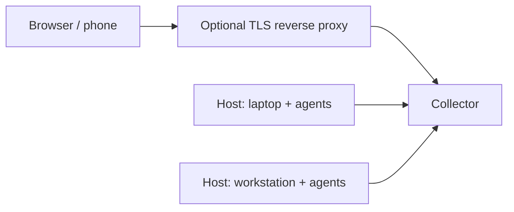

# hennery

hennery is a self-hosted cockpit for coding agents. It lets one developer drive
[Agent Client Protocol](https://agentclientprotocol.com) (ACP) sessions — Claude
Code, Codex, or any other ACP adapter — running on any of their machines, from a
single browser tab or a phone. It also includes an MCP gateway: connect a
server once, then choose its hat and the machines whose sessions may use it.

A **collector** is the server that stores sessions, serves the browser UI and
connects your machines. A **host** is the process on an agent machine that runs
agents against that machine's projects and connects out to the collector.

hennery never proxies agent licences. You bring your own subscriptions and log in
to each agent CLI on your own machines; hennery only drives the sessions.

## Status

**Early testing.** Stable releases are available on GitHub Releases, Homebrew,
crates.io and GHCR.
Stored data may not survive an upgrade: expect things to change.

What works:

- **Sessions from the browser.** The collector serves its web UI from the
  binary. From it you start Claude Code and Codex sessions on a connected,
  paired machine, prompt them, answer their permission requests, and park
  and resume them.
- **Hats.** Path rules put each session in a hat by its project directory,
  for organising sessions and choosing their MCP servers.
- **MCP servers.** Connect a server with a static token or OAuth through the
  gateway, or configure local stdio servers for a host and hat, on the **MCP** screen.
- **Parent/child sessions.** Let a session delegate work to children, receive
  their reports and answer their questions, with operator oversight.
- **Phone answers.** Enable Web Push in **Settings** to open a waiting question
  on your phone and answer it in hennery.
- **Optional memory.** Run the separate `hennery-memory` plug-in for scoped
  session notes, deliberate memories, search and vault import.

Known limitations:

- One owner per collector. Setup requires a password; it also offers a
  passkey, which you can use to sign in afterwards.
- Codex sessions get hennery MCP servers only in the host's default hat, without per-hat isolation, and also load the user's own `~/.codex` MCP servers; other hats get none, until per-hat isolation lands.
- Hosts support verified `wss://`; exact trusted proxy peers provide separate
  client rate-limit budgets. Public adapter/MCP acceptance is pending. Restrict ingress until
  those deployment checks are complete.
- The designs are in [`docs/specs/`](docs/specs/) and the plans in
  [`docs/plans/`](docs/plans/); [`docs/README.md`](docs/README.md) lists
  them.

## Parent/child sessions

Delegation is available for ordinary use, with an explicit per-hat opt-in.
A parent session uses hennery's session tools to spawn a child, choose its
runtime, model and configuration, send follow-ups, inspect progress and close
finished work. Children run on the parent's host and in its hat. There is one
generation of children: a child cannot spawn grandchildren. Git worktrees are
still the agent's responsibility.

Child reports and ordinary questions go back to the parent, which can answer
and steer the work. **Permission requests always go to the operator.** If a
parent cannot handle a child question, hennery brings it to the operator's
attention rather than leaving it hidden. With notifications enabled, that
attention can reach your phone.

The session's family panel links the parent and children and shows their
progress and questions. You can open a child and answer directly, or use
**Take over** to detach it from parent control and handle it yourself.

Live acceptance covers all four Claude Code/Codex parent–child combinations:
Claude→Claude, Claude→Codex, Codex→Claude and Codex→Codex. For a Codex parent,
use at least **`medium` reasoning effort** for reliable session-tool use.
See the [delegation design](docs/specs/2026-10-14-delegation-design.md) and
[family UI and live acceptance record](docs/plans/2026-11-02-delegation-families.md)
for the contract and tested scenarios.

## Optional memory plug-in

`hennery-memory` is a separate, opt-in binary with its own storage and
credentials. Agents use its MCP tools through a hat-scoped gateway connection
and host mount. hennery's plug-in contract separately controls completed
activity access and deletion lifecycle; mounting a server alone does not grant
it transcript access. Core hennery works without the plug-in installed.

The plug-in stores bounded session notes from explicitly granted completed
activity, deliberate memories written by agents or curated by the operator,
and imported notes with their source information. Notes and memories stay
scoped to their owner and hat in a separate SQLite store. Recent, brief and
search tools retrieve that material using deterministic selection and lexical
search. **It uses no LLM**: no embeddings, automatic fact promotion or model
subscription is required.

Its optional management UI has its own authentication and **must use a
dedicated hostname, distinct from hennery's UI and any other application**.
Cookies are not isolated by port, so another port on the same hostname is
not enough. For local use, reserve `localhost` for the memory UI and use
`127.0.0.1` for hennery's UI, with each configured public URL matching the
address you open. The memory UI refuses IP-address origins; use HTTPS for
remote access, through the [memory proxy recipe](packaging/proxy/memory.md).

To import an existing vault, take a snapshot and preview it first. Review
the proposed files and map each to exactly one hat or exclude it, then apply
the reviewed preview. Import is explicit, not an ongoing vault sync. The
management UI also edits and deletes memories and exports scoped Markdown
with source metadata; exported copies and backups remain outside later
deletion guarantees.

See the [memory spec](docs/specs/2026-10-14-memory-design.md),
[service setup and MCP integration](docs/plans/2026-11-01-recall-service.md#operating-the-opt-in-service),
and [management, export and preview/apply instructions](docs/plans/2026-11-03-recall-ui-import.md#operating-the-separate-screen-and-importer).

## Phone answers

In **Settings**, prepare and enable notifications on each browser or installed
app you want to use. On iOS, add hennery to the Home Screen and enable them
from that app. Push notifications open the session's question card, where you
can answer after signing in if needed. There are **no lock-screen replies**;
permission requests still require the operator's answer in hennery.

## Verify a release installer before running it

This procedure targets the 0.3.11 stable release. You need trusted, already installed
`curl`, Git, GnuPG, `jq`, `gh`, and either `sha256sum` or `shasum`.

The release signing subkey's **full fingerprint** is
**`F26C7F594DFE84D131703AFC23E5A318AE8D2861`**. Confirm it through channels
independent of any release: this [README on main](https://github.com/marcinwadon/hennery/blob/main/README.md),
the [maintainer's account keys](https://github.com/marcinwadon.gpg), and
[keys.openpgp.org](https://keys.openpgp.org/vks/v1/by-fingerprint/F26C7F594DFE84D131703AFC23E5A318AE8D2861).
The block below fetches all three and requires the full fingerprint to match.
Stop if a source is unavailable or disagrees; never use a key or verifier
supplied alongside a release as the trust anchor. Review these commands from
main and compare the fingerprint independently before running them.

Set `release_tag` to the published version you intend to install. The block
downloads public data into a private temporary directory and verifies the annotated
tag with an isolated keyring. The maintainer signs source; Sigstore binds the
installer and checksum bytes to that exact tagged workflow and source commit.
The attestation command uses `--cert-identity` for the exact
`release.yml@refs/tags/<tag>` identity, not the mutually exclusive
`--signer-workflow`. It also pins the source ref, source and signer digests,
GitHub Actions issuer, SLSA provenance predicate and hosted runners. The tag
must be annotated, point directly to that source commit and have a valid
signature from the full pinned maintainer fingerprint above.
The block fetches attestations by digest from GitHub without login and authenticates
`SHA256SUMS` and the installer against
the signed tag, exact tagged workflow and source digest, then runs the installer.
The installer repeats these checks for its archive before extraction. Keep the
printed directory for inspection. Only the authenticated installer is executed.

<!-- check: release-bootstrap -->
```sh
(
set -eu
release_fingerprint=F26C7F594DFE84D131703AFC23E5A318AE8D2861
release_tag=v0.3.11
release_dir=$(mktemp -d "${TMPDIR:-/tmp}/hennery-release.XXXXXXXX") || exit 1
printf 'Release verification directory: %s\n' "$release_dir"
mkdir "$release_dir/keyring" || exit 1
chmod 0700 "$release_dir/keyring" || exit 1
printf 'no-autostart\nno-auto-key-retrieve\n' > "$release_dir/keyring/gpg.conf" || exit 1
release_fetch() {
    curl --proto '=https' --proto-redir '=https' --tlsv1.2 -fsSL "$1" -o "$2" || exit 1
}
release_gpg() {
    gpg --batch --no-options --homedir "$release_dir/keyring" --no-autostart --no-auto-key-retrieve "$@"
}
release_git() {
    env GIT_CONFIG_NOSYSTEM=1 GIT_CONFIG_GLOBAL=/dev/null GIT_TERMINAL_PROMPT=0 GIT_NO_REPLACE_OBJECTS=1 \
        GNUPGHOME="$release_dir/keyring" git -c credential.helper= -c core.hooksPath=/dev/null "$@"
}
release_verify_tag() {
    case "$release_tag" in v*) ;; *) return 1 ;; esac
    printf '%s\n' "$release_tag" | LC_ALL=C grep -Eq '^v[0-9]+\.[0-9]+\.[0-9]+(-[0-9A-Za-z.-]+)?$' || return 1
    release_git init --bare --template= "$release_dir/source.git" >/dev/null 2>&1 || return 1
    release_git --git-dir="$release_dir/source.git" fetch --no-tags --depth=1 \
        https://github.com/marcinwadon/hennery.git "refs/tags/$release_tag" >/dev/null 2>&1 || return 1
    release_object=$(release_git --git-dir="$release_dir/source.git" rev-parse FETCH_HEAD) || return 1
    printf '%s\n' "$release_object" | LC_ALL=C grep -Eq '^[0-9a-f]{40}$' || return 1
    release_git --git-dir="$release_dir/source.git" cat-file tag "$release_object" > "$release_dir/tag-object" || return 1
    release_git --git-dir="$release_dir/source.git" -c gpg.format=openpgp -c gpg.program=gpg \
        verify-tag --raw "$release_object" > "$release_dir/tag-output" 2> "$release_dir/tag-status" || return 1
    awk -v fp="$release_fingerprint" '
        $1 == "[GNUPG:]" && $2 == "VALIDSIG" { count++; if ($3 != fp) bad=1 }
        $1 == "[GNUPG:]" && $2 ~ /^(BADSIG|ERRSIG|EXPSIG|EXPKEYSIG|REVKEYSIG|KEYEXPIRED|SIGEXPIRED|KEYREVOKED|NO_PUBKEY|NODATA|FAILURE|ERROR)$/ { bad=1 }
        END { exit !(count == 1 && !bad) }
    ' "$release_dir/tag-status" || return 1
    release_source=$(awk -v tag="$release_tag" '
        /^$/ { done=1 }
        !done && $1 == "object" { objects++; sha=$2; if (NF != 2 || length(sha) != 40 || sha ~ /[^0-9a-f]/) bad=1 }
        !done && $1 == "type" { types++; if ($0 != "type commit") bad=1 }
        !done && $1 == "tag" { tags++; if ($0 != "tag " tag) bad=1 }
        END { if (objects != 1 || types != 1 || tags != 1 || bad) exit 1; print sha }
    ' "$release_dir/tag-object") || return 1
}
release_hash() {
    if command -v sha256sum >/dev/null 2>&1; then
        release_actual=$(sha256sum -b "$1") || return 1
    elif command -v shasum >/dev/null 2>&1; then
        release_actual=$(shasum -a 256 -b "$1") || return 1
    else
        return 1
    fi
    release_digest=$(printf '%s\n' "$release_actual" | awk '{ print $1 }') || return 1
    printf '%s\n' "$release_digest" | LC_ALL=C grep -Eq '^[0-9a-f]{64}$' || return 1
}
release_attest() {
    release_bundle="${HENNERY_ATTESTATION_BUNDLE:-}"
    if [ -z "$release_bundle" ]; then
        release_hash "$1" || return 1
        release_bundle="$release_dir/sha256-$release_digest.jsonl"
        curl -q --proto '=https' --proto-redir '=https' --tlsv1.2 -fsSL \
            --url "https://api.github.com/repos/marcinwadon/hennery/attestations/sha256:$release_digest?per_page=100&predicate_type=provenance" \
            -o "$release_dir/attestations.json" || return 1
        jq -ec '.attestations | select(type == "array" and length > 0) | .[] | .bundle | select(type == "object")' \
            "$release_dir/attestations.json" > "$release_bundle" || return 1
    fi
    [ -s "$release_bundle" ] || return 1
    gh attestation verify "$1" --bundle "$release_bundle" --repo marcinwadon/hennery \
        --cert-identity "https://github.com/marcinwadon/hennery/.github/workflows/release.yml@refs/tags/$release_tag" \
        --source-ref "refs/tags/$release_tag" --source-digest "$release_source" --signer-digest "$release_source" \
        --cert-oidc-issuer https://token.actions.githubusercontent.com --predicate-type https://slsa.dev/provenance/v1 \
        --deny-self-hosted-runners >/dev/null || return 1
}
release_check_hash() {
    release_expected=$(awk -v name="$2" '$2 == name { count++; sha=$1 } END { if (count != 1) exit 1; print sha }' "$release_checksums") || return 1
    release_hash "$1" || return 1
    [ "$release_digest" = "$release_expected" ] || return 1
}
release_verify_payload() {
    [ -s "$release_checksums" ] || return 1
    release_attest "$release_checksums" || return 1
    release_last=$(tail -c 1 "$release_checksums") || return 1
    [ -z "$release_last" ] || return 1
    LC_ALL=C awk '
        { name=$2; lower=tolower(name) }
        length($1) != 64 || $1 ~ /[^0-9a-f]/ || name !~ /^[A-Za-z0-9][A-Za-z0-9._-]*$/ || $0 != $1 "  " name { bad=1 }
        lower == "sha256sums" || lower == "release.sigstore.jsonl" || seen[lower]++ || (NR > 1 && name <= previous) { bad=1 }
        { previous=name }
        END { exit !(NR > 0 && !bad) }
    ' "$release_checksums" || return 1
    release_check_hash "$1" "$2" || return 1
    release_attest "$1" || return 1
}
release_fetch https://raw.githubusercontent.com/marcinwadon/hennery/refs/heads/main/README.md "$release_dir/main-readme"
grep -F -- "$release_fingerprint" "$release_dir/main-readme" >/dev/null || exit 1
release_fetch https://github.com/marcinwadon.gpg "$release_dir/github.asc"
release_fetch "https://keys.openpgp.org/vks/v1/by-fingerprint/$release_fingerprint" "$release_dir/keyserver.asc"
for release_source in github keyserver; do
    release_gpg --with-colons --with-subkey-fingerprint --show-keys "$release_dir/$release_source.asc" > "$release_dir/$release_source.fingerprints" || exit 1
    awk -F: -v fp="$release_fingerprint" '$1 == "fpr" && $10 == fp { found=1 } END { exit !found }' "$release_dir/$release_source.fingerprints" || exit 1
done
release_gpg --import "$release_dir/github.asc" "$release_dir/keyserver.asc" || exit 1
release_verify_tag || exit 1
release_url="https://github.com/marcinwadon/hennery/releases/download/$release_tag"
for release_file in SHA256SUMS hennery-installer.sh; do
    release_fetch "$release_url/$release_file" "$release_dir/$release_file"
done
release_checksums="$release_dir/SHA256SUMS"
release_verify_payload "$release_dir/hennery-installer.sh" hennery-installer.sh || exit 1
HENNERY_RELEASE_CHECKSUMS="$release_checksums" HENNERY_ATTESTATION_BUNDLE="$release_bundle" \
    sh "$release_dir/hennery-installer.sh"
)
```

## Installing

**Stable releases use all four channels below.** The examples target v0.3.11.
Use the verification procedure above for GitHub downloads:

| Channel | Install |
|---|---|
| Homebrew | `brew install marcinwadon/tap/hennery` (0.3.11) from the project's tap. |
| crates.io | `cargo install hennery --version 0.3.11`; the `hennery` crate installs the binary with its embedded UI. |
| GHCR | `docker pull ghcr.io/marcinwadon/hennery:0.3.11`; the collector-only image. Agent hosts run separately on your machines. |
| GitHub Releases | Platform archives and `hennery-installer.sh` on the [Releases page](https://github.com/marcinwadon/hennery/releases), with `SHA256SUMS`, one combined SBOM. Attestations are stored on GitHub. Use the verification procedure above before running the installer. |

Stable releases receive their version tag and `latest`
after image upload and attestation readback succeed; prereleases receive only
their version tag if GHCR publication is enabled for them. See the
[image deployment and verification guide](packaging/images.md).

The six uploaded assets are the three native archives, installer, `SHA256SUMS`
and combined SBOM. Each archive contains `THIRD-PARTY-NOTICES.txt`, including
exact-version crates.io source download links and upstream repositories for MPL
dependencies. Dependency sources are publicly available at those locations.
Hennery's AGPL source is public at the signed release tag and its source commit;
GitHub also attaches automatic **Source code** archives to every release. No
custom source tarballs are uploaded. GitHub's automatic source downloads are
outside the six-asset checksum/attestation set; authenticate their source through
the signed tag and commit.

For a downloaded archive, apply the same signed-tag and exact-workflow
attestation checks to `SHA256SUMS` and the archive,
then compare the archive's SHA-256
with its single entry in the authenticated checksum list before extraction.
The [release contract](packaging/release/README.md#assets-and-verification)
describes these checks. Package-manager installs use their own channel trust;
they do not automatically perform the installer verification above.

See the [Homebrew guide](docs/homebrew.md) for upgrade, removal and the service
PATH/restart requirements. Package operations preserve user data and never
automatically manage services or agent logins. The first-release channel plan
above supersedes that guide's historical GitHub-only alpha rollout note.

## Quickstart

Build with [Nix](https://nixos.org/download/) with flakes enabled, or use
[Build without Nix](#build-without-nix) below. On every machine that runs
agents, you need the CLI for each agent you want to use
already logged in with your own subscription. The flake supports Apple
Silicon macOS, and x86_64 and aarch64 Linux.
The bundled CLIs are not added to your `PATH`. After `up` or `host join`
installs the runtime, run `hennery doctor` on each agent machine. Check 4,
**logged in**, reports whether each agent is logged in and prints a fix when
it is not; doctor does not log in for you.

### Deployment modes



| Mode | Command | What runs | When to choose it |
|---|---|---|---|
| Collector only | `hennery collector` | Server and browser UI; no host or agents | A VM/server that coordinates your agent machines. The GHCR image runs this mode. |
| Host only | `hennery host join <url> <code>`, then `hennery host run` | Agents on this machine, connected to an existing collector | Each laptop/workstation with projects and agent CLI logins. Join pairs it once; run keeps it connected. |
| Both, paired | `hennery up` | Collector and local host, as two child processes | Start everything on one agent machine; other hosts can join later. |

The collector VM does **not** need a host unless you also want to run agents
there. For a local trial, continue with steps 1 and 2 below.

#### Collector on a VM/server behind Caddy

Install or build hennery on the server and each agent machine. Run Caddy on
the **same server** as the collector, with DNS and a trusted TLS certificate
for your chosen public name. Use the [tested Caddyfile and deployment
instructions](packaging/proxy/README.md), setting its backend port to `7117`
and its TLS port to `443`. The template needs your certificate and key paths;
it does not obtain a certificate automatically. It preserves WebSockets and
overwrites the client-address header. Keep ingress restricted to trusted
users while the [public deployment gate](packaging/proxy/README.md#public-deployment-gate)
remains pending.

On the server, start only the collector. Replace `hennery.example` with your
DNS name; `7117` is a collector-backend placeholder for your chosen port:

<!-- check: collector-public -->
```sh
hennery collector --listen 127.0.0.1:7117 --public-url https://hennery.example
```

Loopback is the default so the plaintext backend is reachable only on this
machine; Caddy exposes HTTPS to browsers and hosts. To bind another interface,
use e.g. `--listen 0.0.0.0:7117` (all IPv4 interfaces) or a specific interface
address, and restrict backend access to your proxy. `--listen` is repeatable
and accepts comma-separated addresses, as does `HENNERY_LISTEN`.
`--public-url` / `HENNERY_PUBLIC_URL` sets the browser's origin, not the bind
address; it does not enable TLS on the collector.

Instead of passing flags each time, create `config.toml` in the collector's
data directory (alongside `master.key`):

| Platform / mode | Config file with default data directory |
|---|---|
| Linux, `collector` | `$XDG_DATA_HOME/hennery/config.toml` when XDG_DATA_HOME is absolute; otherwise `~/.local/share/hennery/config.toml` |
| macOS, `collector` | `~/Library/Application Support/hennery/config.toml` |
| `up`, either platform | `collector/config.toml` under that platform's default data directory |

With `--data-dir <dir>` or `HENNERY_DATA_DIR`, the file is `<dir>/config.toml`
for `collector`, or `<dir>/collector/config.toml` for `up`. Startup logs print
the exact path. The file is **not created by default**; create the directory
and file yourself, as the user running the collector. Example for same-server
Caddy (use your DNS name and backend port):

<!-- example: collector-config -->
```toml
listen = ["127.0.0.1:7117"]
public_url = "https://hennery.example"
proxy_client_ip_peers = ["127.0.0.1"]
```

Only trust Caddy's exact backend peer address in `proxy_client_ip_peers`;
the linked recipe overwrites `Hennery-Client-IP` from the connection peer.
Other users must not be able to write the config file. Restart the collector
after editing it. Flags override environment variables, which override the
file, then defaults. Doctor check 16 reads this file, not flags or the URL
stored at setup; keeping `listen` and `public_url` here lets it check your
deployment. Run `hennery doctor` as the collector's user (add `--data-dir <dir>`
for a custom directory).

Open the one-time link in `<collector-data>/setup-url` (also printed when
running in a terminal) through your HTTPS address, and complete setup as in
step 2. For remote access, HTTPS is required: passkeys need a browser secure
context and a DNS name, and hennery sets Secure session cookies on HTTPS.
Local `http://localhost` is the secure-context exception for development;
loopback HTTP uses cookies without Secure. Passkeys are unavailable at IP
addresses, even over HTTPS. Web Push also needs a secure context; on iOS it
needs an installed PWA over HTTPS.

After setup, the saved browser origin takes precedence over `--public-url`
and the file. To move an existing installation, use
`hennery admin reset-public-url https://hennery.example` as described in
[Recovery](#recovery); changing the flag alone does not move it.

On **each agent machine**, use **Hosts → Add host** in the browser to get a
fresh pairing code, run the [HTTPS join command](#3-pair-another-machine), then
`hennery host run`. Keep that process running, or install a host service.
Agent subscriptions and CLI logins belong on those machines, not the
collector-only VM.

### 1. Build

Get the source:

<!-- check: clone -->
```sh
git clone https://github.com/marcinwadon/hennery.git
cd hennery
```

Build the web UI, then the binary, which embeds it. The dev shell brings
Rust, Node and pnpm; with direnv, `direnv allow` once and leave out the
`nix develop -c` prefixes. `HENNERY_WEB_REQUIRE=1` makes the build fail if
the web UI was not built first, instead of embedding a placeholder page.

<!-- check: build -->
```sh
nix develop -c pnpm --dir web install --frozen-lockfile
nix develop -c pnpm --dir web build
HENNERY_WEB_REQUIRE=1 nix develop -c cargo build --release --locked -p hennery
export PATH="$PWD/target/release:$PATH"
```

Or let Nix build the whole package:

<!-- check: nix -->
```sh
nix build
./result/bin/hennery --version
```

The binary is then `result/bin/hennery`; put that directory on your `PATH`
instead.

#### Build without Nix

Prerequisites (plus Git to get the source above):

- **Linux:** a C compiler, `make` and `perl` (including its core modules).
- **macOS:** Xcode Command Line Tools; macOS supplies `perl`.
- **Both:** Rust via [rustup](https://rustup.rs/) (latest stable, the
  toolchain CI uses), and Node 24 with its `npm`/`npx` on `PATH`.

From the source directory, build the web UI with the flake's pinned pnpm
12.3.4 through `npx`, without installing pnpm globally. OpenSSL is built
and linked into the binary; no system OpenSSL is needed.

<!-- check: build-without-nix -->
```sh
npx --yes pnpm@12.3.4 --dir web install --frozen-lockfile
npx --yes pnpm@12.3.4 --dir web build
HENNERY_WEB_REQUIRE=1 cargo build --release --locked -p hennery --features vendored-openssl
export PATH="$PWD/target/release:$PATH"
```

Continue with step 2 below. Starting hennery, setup, `doctor` and agent
logins are the same for both builds.

### 2. Start

<!-- check: up -->
```sh
hennery up
```

`hennery up` runs the collector and a host for this machine, and pairs the
two. It listens on `http://127.0.0.1:7117` and keeps its data in
`~/Library/Application Support/hennery` (macOS) or `$XDG_DATA_HOME/hennery`,
by default `~/.local/share/hennery` (Linux). The first start downloads Node
and the managed adapter set, including its bundled agent CLIs.

On its first start it writes a one-time setup link, valid for an hour, to
`collector/setup-url` in the data directory until setup, and prints the link
when running in a terminal. Open that link: by default it uses
`http://localhost:7117`, which is the browser origin to keep using. Choose
and confirm a password of at least 12 characters, check **Public URL** and
**Default hat**, then press **Set up**. You are signed in; add a passkey or
press **Skip** (or **Continue** if passkeys are unavailable). Back up
`collector/master.key` together with `collector/hennery.db`: the gateway's
credentials cannot be read without it.
If the setup link has expired, `hennery admin setup-url` prints a fresh one.

### 3. Pair another machine

With a verified HTTPS front end, use the public `https://` origin printed by
**Hosts → Add host**: the host enrolls over HTTPS and runs over WSS. System
roots are the default. `host join --ca-cert <file>` imports a private CA for
this collector only and saves it; browsers and adapters need their own trust
configuration. Use `hennery doctor` to check TLS, health and the host upgrade.

To move an existing tunnel pairing, park its sessions and stop the host
service, then use `hennery host transport set <https-origin> --system-roots`
(or `--ca-cert <file>`) with the existing host data directory. This verifies
the existing identity and preserves its key, roots, CLI settings and outbox.
Restarting the host parks adapters; resume sessions normally afterwards.
For CA rotation, save an old-plus-new CA bundle, restart, renew the server,
then save a bundle without the old CA and restart again. Leaf renewal under
the same CA needs no host restart. A `DurabilityUncertain` save means the new
settings are visible but may not survive a crash: inspect the saved endpoint
and repeat the explicit save after storage is healthy.

An uncertain enrollment blocks `join`, `run` and `up`. Follow doctor's attempt
id: inspect the collector's Hosts list, revoke any entry created by that
attempt, then use the explicit enrollment archive action before joining
again. Archiving preserves the journal and key locally; it cannot confirm a
remote revoke. Automatic pairing remains suppressed after an archive.

The SSH tunnel remains an optional deployment choice. On the other machine,
open it with
`ssh -N -L 7117:127.0.0.1:7117 <collector-machine>`; replace
`<collector-machine>` with your SSH destination. Keep this terminal open
while pairing and while `hennery host run` runs. If local port 7117 is
already in use, choose another local port in the tunnel and join command.

For browser access over HTTPS, a reverse proxy on the collector's machine
can serve `up` at an `https://` address, including its host WebSocket. If `up` is already running,
stop it with Ctrl-C and restart it with that address before setup:

<!-- check: up-public -->
```sh
hennery up --public-url https://hennery.example
```

Already set up at `localhost`? Then `--public-url` is ignored: move it
with `hennery admin reset-public-url` (see [Recovery](#recovery)), and from
then on open hennery at the new address, since the old one is refused.
For the collector's machine configuration, set `proxy_client_ip_peers` to
only the proxy's exact backend connection IP (for these loopback recipes,
`["127.0.0.1"]`) in `<collector-data>/config.toml`, then restart the
collector. It is an address budget policy, never login authority. A missing
header falls back to the TCP peer, so local `up` enrollment still works;
without this setting all clients behind the proxy share its limiter budget.
A typo, CIDR, hostname, port, duplicate, unspecified/multicast address, or
more than eight peers fails configuration. IPv4-mapped peers are normalized.

Use the [tested Caddy/nginx recipes](packaging/proxy/README.md). The final
same-machine proxy must overwrite every `Hennery-Client-IP` instance from
its actual connection peer; standard forwarding headers grant nothing.
Restrict backend access, preserve Origin and the upgrade nonce, and apply
edge connection/request caps. A trusted loopback peer also trusts local
processes to assert budget addresses. Healthy HTTPS alone cannot establish
header stripping or two separate client budgets; doctor says so.

The fixture deployment gate covers both recipes and W1 recovery through
them. Public acceptance with both pinned real adapters and mounted MCP is
still pending; keep ingress restricted to a trusted population until the
[public deployment gate](packaging/proxy/README.md#public-deployment-gate)
is recorded. Tailscale Serve needs its own attribution qualification; if
it cannot overwrite an authenticated client address, use a trusted VPN
population and retain the shared-budget limitation.

With that HTTPS origin configured, **Hosts → Add host** supplies the remote
pairing command. Here `hennery.example` is a public-join placeholder for your
collector's DNS name, `443` is a public-join placeholder for its HTTPS port,
and `ABCD-EFGH` is a public-join placeholder for the displayed code. Replace
only those values; retain `https://`. Omitting the code reads it from stdin.

<!-- check: join-public -->
```sh
hennery host join https://hennery.example:443 ABCD-EFGH
```

Run the host block below after pairing. It saves and reconnects through
`wss://<your-origin>/api/hosts/ws`, validating the same server name and roots.
The tunnel command below remains an optional fallback.

In the web UI, **Hosts → Add host** shows a pairing code, valid for ten
minutes, after asking for your password again if a fresh step-up is needed.
Its printed command uses the public URL; when choosing the tunnel, adapt it to the
`http://127.0.0.1` address as below. Build hennery on the other machine and
run the join command in another terminal (it also downloads the runtime).
In this block, `7117` is a placeholder for the tunnel's local port, and
`ABCD-EFGH` is a placeholder for the code shown by **Add host**. Replace
them with your port and code; leave the code out to type it instead and
keep it out of shell history. Keep the `http://127.0.0.1` scheme and host:

<!-- check: join -->
```sh
hennery host join http://127.0.0.1:7117 ABCD-EFGH
```

<!-- check: host-run -->
```sh
hennery host run
```

`host run` uses the saved WSS endpoint for HTTPS pairings. A tunnel pairing
uses `ws://127.0.0.1:<port>/api/hosts/ws`; keep that tunnel port available
on future runs. Transport failures never authorize a fresh pairing.

### 4. Start a session

**New session**: pick a connected host, an agent and a project directory, then
**Start session**, and type your first prompt.
Unless workspace roots are configured, the project list is empty: use
**Browse** under the host user's home, or pass `--workspace-root <directory>`
to `up` or `host run` to list repositories under that root. The flag is
repeatable.

### 5. Connect an MCP server

For a remote server with a static token, open **MCP → Add connection**.
Fill in **Name**, **Slug**, **Server URL** and **Hat**; choose **Token** under
**Authentication**, and set **Header** and **Prefix** as the server requires
(the prefix includes any trailing space). Press **Create**, then enter the
**Token** and press **Save token**. Under **Hosts whose sessions get it**,
tick the hosts to use it; each tick saves immediately. Where delivery is
supported, sessions in that hat on those hosts receive it as
`hennery-<slug>` at their next start or resume.
The status stays **Not used yet** until traffic goes through it.
Use an HTTPS server URL; **Internal network** permits plain HTTP only to
internal addresses (loopback included), for a server you run there.

For a local stdio server, use **MCP → Local MCP servers**. Choose **Host**
and **Hat**, then **Add local server**. Fill in **Server name** and
**Command** (on that host); use **Add argument** for each argument and
**Add environment variable** for secrets. Press **Review local servers**,
check the commands, then **Save local servers**. Saving replaces the whole
set for that host and hat, including removals, at the next start or resume.
Environment values cannot be read back from hennery.

Agents without per-hat isolation receive hennery MCP servers only in the
host's default hat. Check the delivery prediction beside the host or on
**New session** for the agent you chose; the session reports what it was
given at its last start or resume.
This default-hat restriction also applies to Claude with `--use-cli`.

These actions may ask you to confirm your password again.

#### OAuth

In **MCP → Add connection**, fill in the connection fields and choose
**OAuth: automatic registration** under **Authentication** if the vendor
supports dynamic registration, or **OAuth: pre-registered client** if you
register the client yourself. Press **Create**. OAuth addresses must use
HTTPS, or HTTP to this machine.

By default, the vendor must allow hennery's redirect URI:
`<public_url>/api/mcp/oauth/callback`, using the collector's configured
browser origin as `public_url`. The exact URI is shown in the pre-registered
add/edit form and client settings beside **Collector redirect URI to register at the vendor:**
For a pre-registered client, enter **Client ID**, then choose
**Public client (no secret)** or **Set a new secret** under **Client secret action**.
Enter **Client secret** if you chose **Set a new secret**. Press **Save client**.
Saved secrets are write-only and cannot be read back from hennery.

Click **Connect** or **Reconnect** when offered to open the vendor consent
popup. If popups are blocked, use **Open vendor sign-in**. Return to hennery
after consent. If a fresh confirmation is required before authorization,
the popup closes and you confirm your password in the main window (or use
**Confirm with passkey** if offered). Then follow the card and click
**Connect** or **Reconnect** again if offered; authorization is not retried
automatically.

If the vendor permits only a local redirect, select **Localhost callback on
this computer** under **OAuth callback** in the connection's settings.
Enter the exact **Local redirect URI** the vendor permits, including scheme,
host, port and path (default `http://localhost:8976/callback`). HTTP and
HTTPS loopback callbacks are supported. Run the displayed
command on the computer running the browser, then click **Connect** or
**Reconnect**. For example, for collector `https://hennery.example`, the
command is `hennery oauth-callback --collector 'https://hennery.example'
--redirect-uri 'http://localhost:8976/callback'` (one line).
For an existing HTTPS redirect such as `https://127.0.0.1:9882/callback`,
enter that exact URI instead. The receiver generates a temporary self-signed
certificate in memory. After starting it, open **Prepare HTTPS callback** in
the same browser profile, accept the certificate exception for that local
address, and check that the receiver's ready page appears before clicking
**Connect**. Repeat the preparation after restarting the receiver. No key or
certificate is written to disk and no system trust settings are changed.
Use the same browser profile that started Connect. The receiver sends the
browser back to the collector, where its flow cookie, PKCE, exchange and
grant storage are checked as usual. Login, passkeys and MCP URLs still use
the existing public URL.

Keep the receiver terminal open. It listens only on loopback and stops after
15 minutes or Ctrl+C; `--timeout-secs` changes that lifetime (1–86400).
After a timeout, restart the command and start Connect again. For an occupied
port, stop the other receiver or choose another vendor-permitted port in both
the UI and the command. A denial is shown by the collector; reconnect to try
again. **Stop waiting** ends the UI wait; it does not revoke an existing grant.
A manually registered client must already permit the selected local URI.
This option cannot bypass the provider's redirect policy or add permission to
an existing client. Automatic registration uses the selected callback and
reuses a client only when its redirect URI matches.

The card shows the gateway's last report, with **Status recorded** and
**Last checked**. **Probe now** requests a report;
it does not establish live health, and **Working** is a recorded status.
**May need sign-in** (`needs_auth`) calls for **Reconnect**; read the
gateway note, since an authorization-server outage can also cause this state.

## Recovery

Run these on the collector's machine while hennery runs, as the user that
runs it; each asks for confirmation on the terminal. For a collector not in
the default place, give `--data-dir <dir>` right after `admin`.

- **A forgotten password:** set a new one. It signs out every browser session and
  removes every passkey.

  <!-- check: reset-password -->
  ```sh
  hennery admin reset-password
  ```

- **The collector moved** (another address, or behind a proxy): every
  sign-in and change is refused with `origin_mismatch` until hennery knows
  the address the browser now uses. Give it that origin: `https://`, or
  `http://` to a loopback address, with no path. It signs out every browser
  session; passkeys stop working if the host name changes, and are then
  removed.

  <!-- check: reset-public-url -->
  ```sh
  hennery admin reset-public-url https://hennery.example
  ```

## Licence

hennery is licensed under the [GNU Affero General Public License v3.0](LICENSE).

Generated with Claude AI — please review before distribution.
