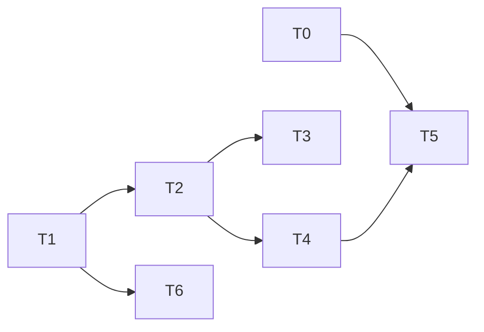

# OMP Adapter Implementation Plan

> **For agentic workers:** You must use `superpowers:subagent-driven-development` or `superpowers:executing-plans` in wave order. Use checkbox (`- [ ]`) syntax to track steps.

**Goal:** Add a persistent external OMP ACP adapter with safe session-file deletion.

**Architecture:** A paired host stores an OMP program path and agent-data root in `host.toml`. Host startup adds OMP after managed adapters and does not wait for Node when OMP is valid. The host proves each new OMP JSONL path before it announces the session. It uses the current forget protocol to delete only the recorded path family.

**Tech Stack:** Rust 2024, Tokio, ACP, TOML, Unix descriptor-based deletion, Cargo tests, Nix.

**Spec:** `docs/superpowers/specs/2026-10-23-omp-design.md`

## Global Constraints

- Keep OMP external. Do not add Bun, an OMP package pin, or OMP credentials to Hennery.
- Add the upstream OMP lease holder before Hennery can delete OMP files.
- Start OMP as `<path> --agent-dir <stored root> acp`.
- Use `HostUse::Adapters` for every OMP adapter command.
- Keep a user `--agent` command as a full replacement for all default agents.
- Map local `Profile::Omp` to wire `RuntimeProfile::Generic`.
- Report `McpIsolation::None` for OMP. Do not add an MCP isolation bypass.
- Remove `OMP_PROFILE`, `PI_PROFILE`, and `PI_CODING_AGENT_SESSION_DIR` from the OMP environment.
- Record the exact OMP JSONL path before `session_started`.
- Delete only the recorded JSONL, its sibling artifact directory, exact backup files, and exact temporary files.
- Do not delete blobs, databases, terminal breadcrumbs, independent forks, or unknown lock files.
- Keep every agent transcript removal inside the current `host_forgets` and `forget_session` lifecycle.
- Keep README shell fences as named `sh` blocks. Put the Fish form in a non-README setup document.

## Task Graph & Waves



| Wave | Tasks |
|---|---|
| 0 | 0, 1 |
| 1 | 2, 6 |
| 2 | 3, 4 |
| 3 | 5 |

---

### Task 0: Upstream OMP writer-lease holder

**Depends on:** None

**Repository:** `can1357/oh-my-pi`

**Files:**
- Modify: `packages/coding-agent/src/cli.ts`
- Modify: `packages/coding-agent/src/cli-commands.ts:215-218`
- Modify: `packages/coding-agent/src/commands/session.ts:23-118`
- Modify: `packages/coding-agent/src/session/profile-bootstrap.ts`
- Modify: `packages/coding-agent/src/session/session-storage.ts:610-631`
- Modify: `packages/coding-agent/src/flag-tables.ts`
- Modify: `packages/utils/src/dirs.ts:364-435,997-999`
- Modify: `packages/utils/src/env.ts:300-325`
- Modify: `docs/cli-reference.md:237-304`
- Create: `packages/coding-agent/test/session-lease-cli.test.ts`
- Modify: `packages/coding-agent/test/cli-argv-routing.test.ts:59-63`

**Interfaces:**
- Produces: `omp --agent-dir /absolute/path session lease hold /absolute/path/session.jsonl --json`.
- Produces: `omp --agent-dir /absolute/path acp`.
- Produces: `omp --agent-dir /absolute/path --help` with exit 0 and no state write.
- Produces: one JSON line with `schemaVersion`, `state`, and `sessionId`.
- Produces: a child process that holds OMP's writer lease until Hennery stops it.

- [ ] **Step 1: Add failing upstream tests.**

Add a route test for `omp --agent-dir <path> session lease hold`. Add held, busy, malformed-header, permission-error, and absent-file cases. Take filesystem snapshots before and after each case. Assert that the command does not change the JSONL, artifact directory, or session data. Add inherited-XDG and project-`.env` cases. Assert that the explicit agent directory wins and that the JSONL stays below it. Start a writer and holder from different CWD values with XDG inputs. Assert that only one gets the same lease.

- [ ] **Step 2: Run the upstream focused tests and confirm failure.**

Run:

```sh
bun test packages/coding-agent/test/session-lease-cli.test.ts packages/coding-agent/test/cli-argv-routing.test.ts
```

Expected: OMP has no `lease` action or `--agent-dir` flag.

- [ ] **Step 3: Add the holder command.**

Parse and remove a global `--agent-dir <absolute path>` flag before CLI, profile, directory, or `.env` bootstrap. Freeze all session and ownership roots from that flag. Give it priority over inherited and `.env` XDG settings. Use one argv form: `omp --agent-dir <path> acp`. Use the same form for the holder command. Read the logical JSONL header. Use the same frozen writer lease as `FileSessionStorage.claimSession`. Keep the lease after standard output flushes. Stop only on process exit or signal. Do not call session mutation code.

```text
held  → {"schemaVersion":1,"state":"held","sessionId":"<exact header ID>"} then wait
busy  → {"schemaVersion":1,"state":"busy","sessionId":"<exact header ID>"} then exit 2
error → {"schemaVersion":1,"state":"error","code":"<stable code>"} then exit 1
```

The holder may create OMP's writer-lock sidecar. It must not create a transcript, rewrite backup, temporary file, artifact, or session directory.

- [ ] **Step 4: Document and verify the holder.**

Document the command in the CLI reference. Run the focused tests. Add a process test where a second OMP writer cannot get the lease while the holder stays alive. Assert that the lease releases after holder exit.

- [ ] **Step 5: Open the upstream contribution.**

Run the upstream test suite and create a draft pull request. Do not publish it as ready until its maintainer accepts the command contract.

- [ ] **Step 6: Record the released capability.**

Record the upstream release that contains the flag and holder. Hennery must run `omp --agent-dir <root> --help` before startup. A nonzero result must suppress OMP and give the direct external-OMP upgrade repair. Hennery must return a retryable no-delete result when the holder is absent.

---

### Task 1: Persisted OMP configuration and CLI

**Depends on:** None

**Files:**
- Modify: `crates/hennery-host/src/identity.rs:307-380`
- Modify: `crates/hennery/src/runtime.rs:14-173`
- Modify: `crates/hennery-host/src/runtime/agents.rs:24-78`
- Modify: `crates/hennery-host/src/lib.rs`
- Modify: `crates/hennery-host/src/identity.rs` tests
- Modify: `crates/hennery/tests/cli.rs:3915-4028`
- Test: `crates/hennery/src/data_dir.rs:290-340`

**Interfaces:**
- Produces: `OmpConfig { executable: PathBuf, agent_data_dir: PathBuf }`.
- Produces: `OmpConfigStatus::{Missing, Valid(OmpConfig), Invalid(String)}`.
- Produces: `read_omp_config`, `set_omp_config`, and `remove_omp_config` in `hennery-host`.
- Produces: `omp_command(&OmpConfig) -> AgentCommand` with `args = ["--agent-dir", root, "acp"]`.
- Produces: `hennery host adapters omp --data-dir <path> set <path> --agent-data-dir <path>`.
- Produces: `hennery host adapters omp --data-dir <path> remove`.

- [ ] **Step 1: Add failing host-configuration tests.**

Add tests that create a paired `host.toml`. Prove that a valid set writes only this table:

```toml
[agents.omp]
executable = "/tmp/omp"
agent_data_dir = "/tmp/omp-agent"
```

Add cases for a relative path, a `.` path part, a `..` path part, and a symlink. Add a non-regular or non-runnable program case. Add a root owned by another user case. Add group-write and other-write permission cases. Add a malformed whole-TOML case that remains byte-for-byte unchanged. Add a valid-TOML invalid-`agents.omp` case that reads as `Invalid`. Add a direct Host and an Up child case with a nondefault data directory.

- [ ] **Step 2: Run the focused tests and confirm failure.**

Run:

```sh
nix develop -c cargo test -p hennery-host identity::tests::omp
```

Expected: the test binary does not compile because the OMP configuration API does not exist.

- [ ] **Step 3: Add the typed configuration API.**

Keep `HostToml` focused on pairing data. Parse `agents.omp` from the raw TOML table after whole-file parsing succeeds. Use `symlink_metadata`, exact absolute-component checks, owner checks, and permission checks. Keep literal paths without canonicalization.

```rust
pub enum OmpConfigStatus {
    Missing,
    Valid(OmpConfig),
    Invalid(String),
}

pub fn read_omp_config(data_dir: &Path) -> Result<OmpConfigStatus>;
pub fn set_omp_config(data_dir: &Path, config: &OmpConfig) -> Result<()>;
pub fn remove_omp_config(data_dir: &Path) -> Result<bool>;
```

Use `write_config_with` for both writes. Preserve `[cli]`, pairing fields, and unknown user fields.

- [ ] **Step 4: Add the `adapters omp` CLI.**

Extend `AdaptersCommand` with an `Omp` nested command. Give its shared argument struct `data_dir: Option<PathBuf>`. Give `Set` an `agent_data_dir` field with `#[arg(long)]`. Resolve the directory through `host_or_installed(..., HostUse::Adapters)`. Validate the full pairing with `Paired::read`, not only the existence of `host.toml`. Do not call `update` or construct download sources.

```rust
pub struct OmpArgs {
    pub data_dir: Option<PathBuf>,
    pub command: OmpCommand,
}

pub enum OmpCommand {
    Set {
        executable: PathBuf,
        #[arg(long)]
        agent_data_dir: PathBuf,
    },
    Remove,
}
```

Make `omp_command` in `runtime::agents` set `args = ["--agent-dir", agent_data_dir, "acp"]`. Task 2 and Task 3 must use this one constructor.

Print that a host restart applies the change. Keep `remove` idempotent.

- [ ] **Step 5: Run configuration and CLI tests.**

Run:

```sh
nix develop -c cargo test -p hennery-host identity::tests::omp
nix develop -c cargo test -p hennery --test cli omp_adapter
nix develop -c cargo test -p hennery --test cli host_adapters_omp_uses_explicit_data_dir
nix develop -c cargo test -p hennery --test cli up_child_loads_omp_from_its_host_directory

Expected: all OMP path, pairing, preserving-write, and remove cases pass.

- [ ] **Step 6: Commit the configuration slice.**

```sh
git add crates/hennery-host/src/identity.rs crates/hennery-host/src/lib.rs crates/hennery-host/src/runtime/agents.rs crates/hennery/src/runtime.rs crates/hennery/tests/cli.rs
git commit -m "feat: configure external OMP adapter" -m "Tokens: unmeasured. Cost: unmeasured."
git log -1 --format=%B
```

### Task 2: OMP startup, environment, and profile

**Depends on:** 1

**Files:**
- Modify: `crates/hennery-host/src/runtime/agents.rs:141-380`
- Modify: `crates/hennery-host/src/adapter.rs:17-49,176-245`
- Modify: `crates/hennery-host/src/profile.rs:8-87`
- Modify: `crates/hennery-host/src/delegation.rs:32-64`
- Modify: `crates/hennery/src/runtime.rs:186-218`
- Modify: `crates/hennery/src/main.rs:917-948,1043-1054,1222-1277`
- Modify: `crates/hennery/src/service/unit.rs`
- Test: `crates/hennery-host/tests/runtime.rs:660-860`
- Test: `crates/hennery-host/tests/adapter_env.rs`
- Test: `crates/hennery-testkit/tests/host_connection.rs:1493-1625`
- Test: `crates/hennery-testkit/tests/session_mcp.rs:129-260`
- Test: `crates/hennery/tests/cli.rs:4057-4143`
- Test: `crates/hennery/tests/service.rs`

**Interfaces:**
- Consumes: `OmpConfigStatus` and `omp_command` from Task 1.
- Produces: `Profile::Omp`, with no session metadata and `McpIsolation::None`.
- Produces: a default-agent result that merges OMP after managed preparation.
- Produces: one sanitized invalid-OMP diagnostic without a configured path.

- [ ] **Step 1: Add failing startup and profile tests.**

Use an ACP fixture that records its arguments and environment. Add cases for:

```text
valid OMP + no adapter set                 → start OMP and print the managed repair command
valid OMP + stale runnable set             → start OMP and that set without update wait
valid OMP + current managed set            → start OMP and managed agents
old OMP without `--agent-dir`              → suppress OMP and print the upgrade repair
invalid OMP                                → log one sanitized diagnostic and use managed flow
persisted OMP + any --agent                → start only explicit agents
Profile::Omp                               → Generic wire profile, none isolation, no meta
Host service and Up child                  → load their persisted OMP configuration
```

Add a command test. It must show the literal `--agent-dir` argument and its stored root. Add inherited-XDG and project-`.env` fixtures. Each must place the proven JSONL below the stored root. Show that `OMP_PROFILE`, `PI_PROFILE`, and `PI_CODING_AGENT_SESSION_DIR` are absent.

- [ ] **Step 2: Run focused tests and confirm failure.**

Run:

```sh
nix develop -c cargo test -p hennery-host runtime::tests::omp
nix develop -c cargo test -p hennery-host --test adapter_env
nix develop -c cargo test -p hennery-testkit --test host_connection hello_announces_mcp_servers_and_how_each_agent_is_isolated
```

Expected: tests fail because startup does not read OMP configuration and `Profile::Omp` does not exist.

- [ ] **Step 3: Compose OMP without a managed-set wait.**

Read OMP configuration before managed preparation. For a valid configuration, run the bounded `omp --agent-dir <root> --help` capability gate in the service environment. Keep its output private. When the gate fails, suppress OMP and print the external-OMP upgrade repair. When the configuration is invalid, log one sanitized diagnostic and run the current managed path. When the capability passes and no set runs, start only OMP and print `hennery host adapters update` for Claude and Codex. When a current or stale set runs, start it with OMP. Start a managed update in the bounded background path. Never await that update before OMP starts. The next host start may use its result.

```rust
let omp = read_omp_config(data_dir)?;
let omp = omp.and_then(check_omp_capability);
let managed = start_current_set_without_wait(omp.is_valid()).await;
let agents = merge_default_agents(managed, omp);
spawn_update_after_start_when_needed(agents);
```

Keep `--agent` as the existing replacement branch in `run_host`.

- [ ] **Step 4: Add OMP-specific environment scrub.**

Do not add a field to `AgentCommand`. It has many literal callers. Add `OMP_PROFILE`, `PI_PROFILE`, and `PI_CODING_AGENT_SESSION_DIR` to the inherited override scrub. Let the Task 0 `--agent-dir` flag control the OMP root.

- [ ] **Step 5: Add the local profile.**

Add `Profile::Omp`. Return `RuntimeProfile::Generic`, `McpIsolation::None`, and no metadata. Add OMP to the unknown security-classification arm. Do not edit `RuntimeProfile` or generated protocol files.

- [ ] **Step 6: Verify MCP behavior and startup.**

Test these cases on both `session/new` and `session/load`:

```text
no MCP capability                  → Unsupported and no servers
default hat with collector waiver  → Unisolated and delivered servers
default hat without waiver         → refusal before OMP spawn
other hat                           → Fallback, no servers, no waiver
```

Run the secret-redaction cases with `Profile::Omp`. Run the Host-service and Up-child fixtures. Then run:

```sh
nix develop -c cargo test -p hennery-host --test runtime
nix develop -c cargo test -p hennery-host --test adapter_env
nix develop -c cargo test -p hennery-testkit --test host_connection
nix develop -c cargo test -p hennery-testkit --test session_mcp
nix develop -c cargo test -p hennery --test cli
nix develop -c cargo test -p hennery --test service
```

Expected: OMP reports the specified delivery. Direct unwaived input fails before spawn. A fallback never carries a waiver or a server.

- [ ] **Step 7: Commit the startup slice.**

```sh
git add crates/hennery-host/src/runtime/agents.rs crates/hennery-host/src/adapter.rs crates/hennery-host/src/profile.rs crates/hennery-host/src/delegation.rs crates/hennery/src/runtime.rs crates/hennery/src/main.rs crates/hennery/src/service/unit.rs crates/hennery-host/tests/runtime.rs crates/hennery-host/tests/adapter_env.rs crates/hennery-testkit/tests/host_connection.rs crates/hennery-testkit/tests/session_mcp.rs crates/hennery/tests/cli.rs crates/hennery/tests/service.rs
git commit -m "feat: start persisted OMP adapter" -m "Tokens: unmeasured. Cost: unmeasured."
git log -1 --format=%B
```

### Task 3: OMP doctor checks

**Depends on:** 2

**Files:**
- Modify: `crates/hennery/src/doctor/agents.rs:41-230`
- Modify: `crates/hennery/src/doctor/spawn.rs:37-67,340-388`
- Test: `crates/hennery/src/doctor/tests.rs:1755-2010`

**Interfaces:**
- Consumes: the Task 2 effective-agent selector and Task 1 `omp_command`.
- Produces: the same effective adapter set as host startup.
- Produces: an OMP version verdict that uses exit success, not a text prefix.

- [ ] **Step 1: Add failing doctor tests.**

Add cases where OMP is configured with no adapter set, `--version` succeeds, ACP initialize succeeds, and doctor reports both checks. Add failure cases for a missing program, an unsafe root, nonzero `--version`, and failed ACP initialize. Add a mixed case where OMP passes while a managed agent fails. Add a valid-OMP current-set-without-Node case. Assert that Doctor and Host select the same agents.

- [ ] **Step 2: Run the focused doctor tests and confirm failure.**

Run:

```sh
nix develop -c cargo test -p hennery doctor::tests::omp
```

Expected: tests fail because doctor returns `no adapter set installed and no --agent`.

- [ ] **Step 3: Use the shared effective-agent selector.**

Use the Task 2 selector and Task 1 `omp_command`. Doctor must include valid OMP when no set exists. It must omit a managed agent when its Node binary is absent. It must retain explicit `--agent` precedence.

- [ ] **Step 4: Add the two OMP checks.**

Run `<path> --agent-dir <root> --help` through the bounded CLI runner in the service environment before any OMP doctor check. Keep output private. A nonzero result must give the external-OMP upgrade repair. Run `<path> --version` through the same bounded runner. Treat exit success as version evidence. Run ACP initialize through the current adapter-start path and normal host environment. Do not add a login-status command.

- [ ] **Step 5: Run doctor regression tests.**

Run:

```sh
nix develop -c cargo test -p hennery doctor::tests
```

Expected: Doctor and Host select the same OMP and managed agents. OMP failures name an OMP repair command. Existing Claude and Codex checks keep their current verdicts.

- [ ] **Step 6: Commit the doctor slice.**

```sh
git add crates/hennery/src/doctor/agents.rs crates/hennery/src/doctor/spawn.rs crates/hennery/src/doctor/tests.rs
git commit -m "feat: diagnose external OMP adapter" -m "Tokens: unmeasured. Cost: unmeasured."
git log -1 --format=%B
```

### Task 4: OMP session proof, durable record, and close

**Depends on:** 2

**Files:**
- Modify: `crates/hennery-host/src/agent_home.rs:20-156`
- Modify: `crates/hennery-host/src/session.rs:1007-1053,1577-1584,2292-2310,2437-2510`
- Modify: `crates/hennery-testkit/src/lib.rs:8-325`
- Modify: `crates/hennery-testkit/src/bin/hennery-fake-acp.rs:148-230`
- Test: `crates/hennery-testkit/tests/forget.rs:238-330`
- Test: `crates/hennery-testkit/tests/host_session.rs:473-560`

**Interfaces:**
- Consumes: `Profile::Omp`, `OmpConfig`, and the OMP ACP ID.
- Produces: durable `OmpSessionFile { agent_session_id, program, root, cwd, jsonl }`.
- Produces: a durable OMP `AgentHome { root, sqlite_root: None }` in `session_started`.
- Produces: one current record for an exact OMP agent, ID, root, CWD, and JSONL path.
- Produces: `Registry::record_omp` and `Registry::lookup_omp`.
- Produces: an ACP `session/close` request only for a supported OMP session.

- [ ] **Step 1: Add failing session-proof and registry tests.**

Extend the fake ACP fixture to write a JSONL after `session/new`. Put a title line before the logical header. Add these cases:

```text
one exact header ID and canonical CWD       → record P before SessionStarted
no match or more than one match             → fail before SessionStarted
symlink, outside-root path, ID, or CWD miss → fail before SessionStarted
registry write failure                      → fail before SessionStarted
agent-home write failure                    → fail before SessionStarted
host restart then session/load              → look up the same durable program, P, and CWD
```

Add close cases for OMP with the `close` capability, OMP without it, Claude, Codex, Generic, a close error, and a close timeout.

- [ ] **Step 2: Run the focused tests and confirm failure.**

Run:

```sh
nix develop -c cargo test -p hennery-testkit --test forget omp
nix develop -c cargo test -p hennery-testkit --test host_session close
```

Expected: no durable OMP record exists, and close sends no OMP-only request.

- [ ] **Step 3: Add the durable OMP record.**

Create an `omp_session_files` SQLite table. Store one current row for agent, ACP session ID, program, literal root, canonical CWD, and JSONL path. Keep it separate from `agent_homes`. Store the literal `P` and canonical CWD after proof and before `session_started`. Record an OMP `AgentHome` in the same start gate. A record error must stop session start. Reject an ambiguous lookup.

```rust
pub struct OmpSessionFile {
    pub agent_session_id: String,
    pub program: PathBuf,
    pub root: PathBuf,
    pub cwd: PathBuf,
    pub jsonl: PathBuf,
}

pub fn record_omp(&self, file: &OmpSessionFile) -> Result<()>;
pub fn lookup_omp(&self, id: &str, root: &Path) -> Result<Option<OmpSessionFile>>;
```

Extend `agent_home::resolve` for OMP with the configured root. Emit this OMP home in `session_started`. Scan only `<agent_data_dir>/sessions/*/*.jsonl`. Open files without following links. Parse to the logical `session` header. Check the exact ACP ID and canonical CWD. Do not infer a path from an ID or filename.

- [ ] **Step 4: Close only OMP through ACP.**

For `Profile::Omp`, check the negotiated `sessionCapabilities.close`. When it is true, send `session/close` and wait for its bounded reply. Then keep the existing process-group stop and `session_closed` order. When it is false, do not send the request. Keep the current close path for Claude, Codex, and Generic. Do not delete the OMP tree.

- [ ] **Step 5: Run session and registry tests.**

Run:

```sh
nix develop -c cargo test -p hennery-testkit --test forget
nix develop -c cargo test -p hennery-testkit --test host_session
```

Expected: the durable program, record, and OMP agent home survive restart. OMP close uses ACP when supported. Other profiles keep their current close path.

- [ ] **Step 6: Commit the session slice.**

```sh
git add crates/hennery-host/src/agent_home.rs crates/hennery-host/src/session.rs crates/hennery-testkit/src/lib.rs crates/hennery-testkit/src/bin/hennery-fake-acp.rs crates/hennery-testkit/tests/forget.rs crates/hennery-testkit/tests/host_session.rs
git commit -m "feat: record and close OMP sessions" -m "Tokens: unmeasured. Cost: unmeasured."
git log -1 --format=%B
```

### Task 5: OMP forget lifecycle

**Depends on:** 0, 4

**Files:**
- Modify: `crates/hennery-host/src/forget.rs:70-150`
- Modify: `crates/hennery-host/src/walk.rs:1-175,399-421`
- Modify: `crates/hennery-host/src/connection.rs:1060-1175`
- Modify: `crates/hennery-sessions/src/forget.rs:236-310`
- Modify: `crates/hennery-sessions/src/store.rs:3260-3390`
- Test: `crates/hennery-testkit/tests/forget.rs`
- Test: `crates/hennery-testkit/tests/forget_host.rs:247-420`

**Interfaces:**
- Consumes: a durable `OmpSessionFile` and OMP `AgentHome` from Task 4.
- Consumes: `omp --agent-dir root session lease hold P --json` from the record's program.
- Produces: a retry-safe `host_forgets` result with kinds and counts.

- [ ] **Step 1: Add failing forget tests.**

Create recorded `P`, its sibling artifact directory, `P.<16 lowercase hex>.bak`, and `.${basename(P)}.<16 lowercase hex>.tmp`. Add these cases:

```text
valid holder and safe paths                   → remove the exact OMP family
busy holder, error, invalid JSON, old schema  → retain and retry
live Hennery actor or external OMP writer     → retain and retry
unknown or non-UUID OMP ID                    → use only an exact durable record
same-ID and same-CWD atomic rewrite           → remove
different ID or CWD after registry write      → retain and retry
unsafe owner, mode, link, or parent           → retain and retry
near backup or temporary name                 → retain
adapter removal then host restart             → use the stored program and root
unrelated JSONL, blob, database, breadcrumb   → retain
```

Add an independent fork outside the recorded artifact directory. Assert that it stays. Add a collector-to-host forget test. Assert that the OMP agent home reaches `host_forgets`. Assert kinds and counts, never paths.

- [ ] **Step 2: Run the forget tests and confirm failure.**

Run:

```sh
nix develop -c cargo test -p hennery-testkit --test forget omp
nix develop -c cargo test -p hennery-testkit --test forget_host omp
```

Expected: OMP is rejected as an unsupported agent or has no exact durable record.

- [ ] **Step 3: Dispatch OMP with opaque IDs.**

Keep collector sequencing unchanged. Let the store write `host_forgets` before scrub. Key OMP sharing by `(agent_session_id, AgentHome.root)`. Keep ID-only sharing for Claude and Codex. For OMP, accept a nonempty UTF-8 ID of at most 512 bytes only after `lookup_omp` returns its exact root and ID. Never build a path from the ID.

- [ ] **Step 4: Hold the writer lease and recheck paths.**

Before holder spawn, validate the stored program, root, and `P` through descriptor-relative no-follow operations. Start the Task 0 holder with that validated stored program, root, and `P` in the OMP service environment. Get one held JSON line within five seconds. Check schema version 1 and the exact recorded ID. Keep the holder alive until deletion completes.

Open the parent and every candidate through descriptor-relative no-follow operations. Check that `P`, backups, and temporary files are private regular files with one link. Check that the artifact path is a private directory. Reject a link, unsafe owner, or unsafe mode in its recursive descriptor walk. Recheck the exact logical header ID and canonical CWD. Refuse every uncertain path.

Remove only `P`, `P` without `.jsonl`, `P.<16 lowercase hex>.bak`, and `.${basename(P)}.<16 lowercase hex>.tmp`. Verify absence. Stop and reap the holder in every result path. Leave its lock sidecar and every unknown file.

- [ ] **Step 5: Verify retry and deletion safety.**

Run:

```sh
nix develop -c cargo test -p hennery-testkit --test forget
nix develop -c cargo test -p hennery-testkit --test forget_host
nix develop -c cargo test -p hennery-testkit --test forget_claude
nix develop -c cargo test -p hennery-testkit --test forget_codex
```

Expected: OMP deletion needs a live holder and exact durable record. Claude and Codex deletion remain unchanged.

- [ ] **Step 6: Commit the forget slice.**

```sh
git add crates/hennery-host/src/forget.rs crates/hennery-host/src/walk.rs crates/hennery-host/src/connection.rs crates/hennery-sessions/src/forget.rs crates/hennery-sessions/src/store.rs crates/hennery-testkit/tests/forget.rs crates/hennery-testkit/tests/forget_host.rs
git commit -m "feat: remove recorded OMP session files" -m "Tokens: unmeasured. Cost: unmeasured."
git log -1 --format=%B
```

### Task 6: OMP setup documentation

**Depends on:** 1

**Files:**
- Create: `docs/omp.md`
- Modify: `README.md:602-610`
- Modify: `crates/hennery/tests/readme.rs:38-54,482-535`

**Interfaces:**
- Consumes: the Task 1 command contract.
- Produces: one tested README `sh` block and a linked OMP setup document.

- [ ] **Step 1: Add failing documentation tests.**

Add `omp-setup` to the README block list. Add a `Machine` helper that creates a runnable fake `omp` in its temporary `PATH`. Create `$HOME/.omp/agent` with safe mode. Run the README Bash block after paired-host setup. Extract the `docs/omp.md` Fish block. Run it through `fish --no-config -c` on the same fixture. Assert that each form stores the fake program and the scratch agent-data root. Assert that the README links to the setup document.

- [ ] **Step 2: Run the focused test and confirm failure.**

Run:

```sh
nix develop -c cargo test -p hennery --test readme omp_setup
```

Expected: the `omp-setup` block does not exist.

- [ ] **Step 3: Write the setup guide.**

Create `docs/omp.md`. State that OMP stays external and unpinned. State that the operator installs and authenticates OMP as the service OS user. Include both forms:

```sh
hennery host adapters omp set "$(command -v omp)" --agent-data-dir "$HOME/.omp/agent"
```

```fish
hennery host adapters omp set (command -v omp) --agent-data-dir $HOME/.omp/agent
```

Explain that terminal credentials can differ from service credentials. Explain the default-hat MCP fallback. Explain that the waiver must be explicit.

- [ ] **Step 4: Add the README command and link.**

Add one named `sh` block with the Bash command to the paired-host section of `README.md`. Link to `docs/omp.md`. Do not add a Fish fence to `README.md`.

- [ ] **Step 5: Run documentation tests.**

Run:

```sh
nix develop -c cargo test -p hennery --test readme
```

Expected: the README Bash block and the setup-document Fish block run in a scratch machine. Every README shell block has a runner.

- [ ] **Step 6: Commit the documentation slice.**

```sh
git add docs/omp.md README.md crates/hennery/tests/readme.rs
git commit -m "docs: explain external OMP setup" -m "Tokens: unmeasured. Cost: unmeasured."
git log -1 --format=%B
```

## Final verification

- [ ] Run the repository pre-flight on the final commit.

Run these commands in Bash and Fish. The commands are the same. Run the Linux-only lines on a Linux CI runner. First run the CI path selector. Run each selected job command.

```sh
env GITHUB_EVENT_NAME="$GITHUB_EVENT_NAME" python3 packaging/ci-paths.py --base "$BASE_SHA"
env CI=1 HENNERY_WEB_REQUIRE=1 nix develop .#web -c pnpm --dir web install --frozen-lockfile
env CI=1 HENNERY_WEB_REQUIRE=1 nix develop .#web -c pnpm --dir web typecheck
env CI=1 HENNERY_WEB_REQUIRE=1 nix develop .#web -c pnpm --dir web test
env CI=1 HENNERY_WEB_REQUIRE=1 nix develop .#web -c pnpm --dir web build
env CI=1 nix develop -c pnpm --dir web e2e
nix develop -c sh -c 'node --check crates/hennery-memory/src/ui-client.mjs && node --test crates/hennery-memory/tests/ui-client.test.mjs'
nix develop -c cargo build -p hennery -p hennery-testkit --bins --locked
env CI=1 nix develop -c sh -c 'cargo build -p hennery-memory --bin hennery-memory --locked && node crates/hennery-memory/tests/browser.mjs'
nix develop -c cargo fmt --all --check
nix develop -c cargo clippy --workspace --all-targets --locked -- -D warnings
nix develop -c cargo clippy -p hennery --locked -- -D warnings
env RUNNER_OS=Linux HENNERY_WEB_REQUIRE=1 HENNERY_REQUIRE_SHELLS=bash,zsh,fish HENNERY_REQUIRE_SYSTEMD_ANALYZE=1 nix develop -c sh packaging/ci-rust-tests.sh
nix develop -c cargo run -p hennery-proto --bin gen --locked -- --check
nix develop -c cargo run -p hennery-view --bin gen-view --locked -- --check
nix develop -c cargo test -p hennery --test readme
```

Keep `GITHUB_EVENT_NAME` and `BASE_SHA` equal to the CI event values. Run the Linux and macOS README recipe jobs from `.github/workflows/ci.yml` when the selector sets `recipes=true`. Run the macOS smoke job when the selector sets `macos=true`.

- [ ] Start the configured OMP path in a disposable paired-host fixture. Confirm `acp`, the data-root environment, JSONL proof, close order, and forget retry.
- [ ] Run the live OMP ACP gate with the configured service OS user. Confirm initialize and one model prompt. Do not print credentials or transcript content.
- [ ] Update the OMP design if the live gate changes any source-backed assumption.
