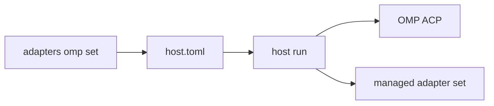

# OMP adapter design

**Date:** 2026-10-23

**Status:** Proposed

**Goal:** Let a paired Hennery host run a locally installed OMP ACP agent as a persistent first-class adapter.

**Scope:** This design adds an external OMP adapter. It does not bundle OMP, Bun, or provider credentials.

## Evidence

OMP documents `omp acp` as its ACP command. It uses standard input and standard output for ACP JSON-RPC. See <https://omp.sh/docs/acp>.

The official package is `@oh-my-pi/pi-coding-agent`. Version `18.12.6` needs Bun `>=1.3.14`. See <https://registry.npmjs.org/@oh-my-pi%2fpi-coding-agent/18.12.6>.

Hennery's managed adapter set starts each adapter with its pinned Node runtime. See `crates/hennery-host/src/runtime/agents.rs`.

The installed OMP command reports `omp/18.12.6` on 2026-10-23.

## Root cause

**Hypothesis:** Hennery cannot treat OMP as a Node managed adapter.

**Evidence:** The OMP package declares Bun as its runtime. The Hennery set has only Node.

**Alternative rejected:** A generic `--agent 'omp=omp acp'` command works. It is transient, generic, and cannot remove recorded OMP session files.

## Decisions

1. Hennery supports OMP as an external program.
2. Hennery does not install OMP, Bun, or provider credentials.
3. An operator supplies an absolute program path and an OMP agent-data directory.
4. The host starts the program as `<path> --agent-dir <root> acp`.
5. The configuration persists in `host.toml`.
6. A persisted OMP command has local `Profile::Omp`. A user `--agent omp=…` command remains `Profile::Generic`.
7. `Profile::Omp` maps to the existing wire `RuntimeProfile::Generic`. Hennery must not add a wire OMP profile.
8. OMP reports `McpIsolation::None`. The host refuses MCP servers unless the collector waives isolation.
9. ACP mode does not auto-discover OMP on-disk MCP configuration. This fact does not prove a configured program.
10. Hennery owns the top-level OMP session tree that it starts. It records the tree before `session_started`.
11. Hennery closes an OMP ACP session before it stops the adapter process. ACP close does not delete its files.
12. Hennery removes recorded OMP session files through the existing forget lifecycle.
13. Hennery supports the OMP default profile only. Named profiles and custom session directories are out of scope.

## Command contract

Add these commands under `hennery host adapters`:

```text
hennery host adapters omp set /absolute/path/to/omp --agent-data-dir /absolute/path/to/omp-agent
hennery host adapters omp remove
```

Both commands must resolve the data directory with `HostUse::Adapters`. They must fail without a paired host.

`set` must reject a non-absolute path. It must reject `.` and `..` path parts. It must reject a non-regular file and a file without run permission.

`set` must reject a symlink, a root not owned by the host user, and a group-writable or other-writable directory.

`remove` must succeed if no OMP configuration exists. It must remove only `agents.omp`.

Both commands must use the atomic private `host.toml` writer. A malformed whole `host.toml` must fail with no write.

Neither command downloads a managed adapter set. Neither command changes Claude or Codex configuration.

The change applies at the next host start. It does not change a live session.

## Persistent configuration

Store the program path and OMP default-profile root in the paired host configuration.

```toml
[agents.omp]
executable = "/absolute/path/to/omp"
agent_data_dir = "/absolute/path/to/omp-agent"
```

The configured session root is `agent_data_dir/sessions`. The operator must configure OMP credentials in this agent-data directory.

The OMP command gets `--agent-dir agent_data_dir`. This upstream flag must override every XDG and `.env` root value. The host also removes `OMP_PROFILE`, `PI_PROFILE`, and `PI_CODING_AGENT_SESSION_DIR`.

The host must recheck the stored path and directory on every start. It must keep the literal path and must not canonicalize it. Before it starts OMP, host and doctor must run `<path> --agent-dir <root> --help` in the service environment. A nonzero result must suppress OMP and report an external-OMP upgrade repair.

A valid TOML file with an invalid `agents.omp` value must omit OMP and log one sanitized diagnostic. Invalid TOML, unsafe configuration-file metadata, and an invalid pairing remain fatal.

A Host service runs `hennery host run --data-dir <paired-host-dir>`. An Up service gives its child `<up-data-dir>/host`. Both use the same persisted configuration.

## Startup data flow



Without `--agent`, the host merges valid OMP with the current managed set.

With any `--agent`, the explicit commands replace all defaults. They suppress managed adapters and persisted OMP.

When valid OMP exists and no runnable managed set exists, the host must start OMP without a managed-set install wait. It must report that Claude and Codex need `hennery host adapters update`.

When valid OMP exists, a managed-set update must not block host startup. The next host start uses the updated set.

Without valid OMP, managed-agent start behavior remains unchanged.

The configured OMP command has `program = <path>` and `args = ["--agent-dir", agent_data_dir, "acp"]`. The host keeps its environment scrub and process-group supervision.

## Profile and MCP behavior

`Profile::Omp` has empty session metadata and `McpIsolation::None`. Its security classification is unknown. It has no static catalog and no cross-runtime permission-mode mapping.

The profile comes from persisted OMP configuration, not an agent name.

| Host capability | Hat | Delivery | Result |
|---|---|---|---|
| No MCP capability | Any | None | `Unsupported`; no servers |
| MCP capability | Default | Unisolated | Servers only with collector waiver |
| MCP capability | Other | Fallback | No servers and no waiver |

The host must reject direct nonempty and unwaived MCP input before it starts OMP. It must return `mcp_isolation_unavailable`.

The host must pass the same delivery to ACP `session/new` and every `session/load`. The collector keeps transactional gateway token mint and revoke.

## Session files and deletion

OMP ACP does not return a session-file path. Hennery must not derive one from the ACP ID or filename.

After ACP `session/new`, Hennery scans direct project directories under the configured session root. It must find exactly one regular JSONL file with the ACP ID and expected canonical workspace path.

Hennery must parse the logical `session` header. It must not assume that the physical first line is the header.

Hennery must not pass `--provider-session-id`, `--session-dir`, or a named OMP profile. These options break the recorded ACP-ID mapping or session reload.

Before `session_started`, Hennery records the ACP ID, program path, literal root, canonical CWD, JSONL path `P`, and agent-data root. It also records the OMP agent home. It must refuse the start if any record write fails.

The session tree is `P`, its sibling artifact directory, exact rewrite backups, and exact rewrite temporary files. Hennery must not delete blobs, databases, terminal breadcrumbs, independent forks, or unknown lock files.

On close, Hennery must send ACP `session/close`, wait for the response, stop the process group, and emit `session_closed`.

On delete, the collector must create `host_forgets` before it scrubs the session. The host must wait until no actor owns the ACP ID.

The host must recheck the stored program, root, and `P` through no-follow descriptors. It must then start `<path> --agent-dir <root> session lease hold P --json`.

The successful line must have `schemaVersion: 1`, `state: "held"`, and the exact ACP ID. The process must hold the lease until Hennery stops it.

While the holder runs, Hennery must recheck ownership, mode, exact ID, canonical CWD, no symlink, and parent descriptors. It may then remove only recorded paths and verify absence.

The holder command must not write session data. It may create OMP's persistent lock sidecar. Hennery must not delete that sidecar.

If the command is absent, rejects the path, gives invalid JSON, gives an unsupported schema, or cannot hold the lease, Hennery must remove nothing. It must report a retryable failure.

The forget result must report kinds and counts, never paths. It must report failures and retry after host reconnect.

## Doctor behavior

When OMP is configured, doctor must derive the same effective adapter set as host startup. A valid OMP configuration is enough when no managed set exists.

Doctor must run `<path> --version` in the service environment. It must use the existing bounded CLI process-group rules and must not print raw output.

The CLI reference promises that `--version` prints an installed version. It does not promise a stable OMP text prefix. A success exit is the version check. ACP `initialize` is the protocol check.

Doctor must start `<path> acp` with the normal host environment. It must not use the update-disabled CLI environment for ACP.

Doctor must state that it cannot check OMP login state. It must not read credentials or start interactive login.

Doctor must report a missing path, an unsafe agent-data root, a failed command, or a failed ACP initialization with a direct repair command.

## Documentation

The README must have one named `sh` block. It must link to an OMP setup document.

The OMP setup document must show this equivalent command in both shells:

```sh
hennery host adapters omp set "$(command -v omp)" --agent-data-dir "$HOME/.omp/agent"
```

```fish
hennery host adapters omp set (command -v omp) --agent-data-dir $HOME/.omp/agent
```

The document must state that OMP is external and unpinned. It must tell the operator to set up OMP under the service OS user and agent-data directory.

The document must state that terminal credentials do not prove service-visible credentials. It must state the MCP waiver and default-hat fallback.

## Needs and checks

| ID | Need | Check |
|---|---|---|
| R1 | The command stores safe absolute program and agent-data paths. | Unit tests for accepted and refused paths. |
| R2 | Remove preserves pairing and other adapter configuration. | Host configuration integration test. |
| R3 | Default startup starts OMP with `acp` and its agent-data directory. | CLI test with an ACP fixture. |
| R4 | OMP starts without a set or Node wait. | CLI tests for no set and missing Node. |
| R5 | Manual `--agent` suppresses persisted OMP and remains generic. | CLI and profile tests. |
| R6 | OMP MCP delivery covers start, resume, fallback, waiver, refusal, and secret redaction. | Host and session MCP tests. |
| R7 | Doctor finds OMP without a set and isolates OMP errors from managed-agent errors. | Doctor success and failure fixtures. |
| R8 | Host and Up services load one OMP configuration. | Service command and startup tests. |
| R9 | Hennery records one exact OMP JSONL path before `session_started`. | ACP fixture test with header and CWD mismatch cases. |
| R10 | Close sends ACP close but keeps the OMP tree. | Host-close regression test. |
| R11 | Delete removes only the recorded JSONL family and retries a failed forget. | Forget tests for path, symlink, writer, retry, and count cases. |
| R12 | README and setup document show checked Bash and Fish commands. | README block and documentation tests. |
| R13 | Protocol artifacts remain current. | `hennery-proto` generation check. |
| R14 | OMP supplies a holder process for its writer lease. | Upstream OMP held, free, error, and no-mutation tests. |

## Out of scope

- A Bun runtime in the managed adapter set.
- An OMP package pin, lockfile, package signature, or release update workflow.
- Automatic OMP installation or update.
- Provider login checks or credential copying.
- Claims of strict MCP isolation.
- Named OMP profiles, custom session directories, and provider session IDs.
- Deletion of global OMP blobs, databases, terminal breadcrumbs, or independent forks.

## Rejected alternatives

| Alternative | Decision | Reason |
|---|---|---|
| Bundle OMP and Bun | Rejected | This changes Hennery distribution trust and CI. |
| Document `--agent 'omp=omp acp'` only | Rejected | The command is transient and generic. |
| Mark all OMP ACP processes as strict | Rejected | A configured external path has no provenance proof. |
| Use third-party `omp-acp` | Rejected | OMP provides `omp acp` itself. |
| Leave OMP files after delete | Rejected | ACP core requires agent transcript removal and retry. |
| Use a read-only OMP lease probe | Rejected | A writer can take the lease after the probe exits. |

## Verification commands

Run these commands in Bash and Fish. The commands are the same. Run the Linux-only lines on a Linux CI runner.

```sh
env GITHUB_EVENT_NAME="$GITHUB_EVENT_NAME" python3 packaging/ci-paths.py --base "$BASE_SHA"
env CI=1 HENNERY_WEB_REQUIRE=1 nix develop .#web -c sh -c 'pnpm --dir web install --frozen-lockfile && pnpm --dir web typecheck && pnpm --dir web test && pnpm --dir web build'
env CI=1 nix develop -c pnpm --dir web e2e
nix develop -c cargo build -p hennery -p hennery-testkit --bins --locked
nix develop -c cargo fmt --all --check
nix develop -c cargo clippy --workspace --all-targets --locked -- -D warnings
nix develop -c cargo clippy -p hennery --locked -- -D warnings
env RUNNER_OS=Linux HENNERY_WEB_REQUIRE=1 HENNERY_REQUIRE_SHELLS=bash,zsh,fish HENNERY_REQUIRE_SYSTEMD_ANALYZE=1 nix develop -c sh packaging/ci-rust-tests.sh
nix develop -c cargo run -p hennery-proto --bin gen --locked -- --check
nix develop -c cargo run -p hennery-view --bin gen-view --locked -- --check
nix develop -c cargo test -p hennery --test readme
```

Run the repository pre-flight command on the final commit. Use the exact repository command that CI names.
